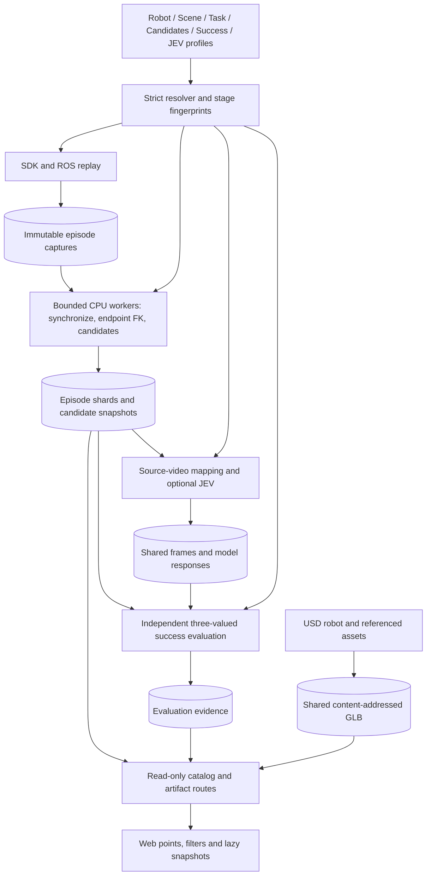

# Placement configuration and artifact architecture

Placement analysis preserves the SDK/ROS feedback capture contract while making
offline stages independently repeatable. It does not replace measured feedback
with dataset targets or run a second simulation path.



## Configuration composition

The JSON experiment schema has `schema_version: 1` and the sections `robot`,
`scene`, `task`, `candidates`, `success`, `jev`, `source`, `runtime` and `output`.
Each section is inline or uses `{ "ref": "relative/profile.json", "overrides":
{ ... } }`. References resolve relative to the declaring file. Object overrides
merge recursively; arrays and scalar values replace their predecessor. Cycles,
duplicate JSON keys, unknown placement-schema fields and invalid cross-references
are rejected. Simulation overrides may change only keys already declared in the
selected simulator YAML; the backend remains responsible for its runtime schema.
Robot model and simulation-config paths retain the repository-root-relative
asset convention; absolute paths are also supported.

The checked-in `press_cube.json`, `penholder.json` and `cap_pen.json` assemble
shared profiles. Legacy flat task JSON remains an explicit input adapter.
Normalized settings carry resolved sections and fingerprints for downstream
adapters; the original candidate-generation snapshot is retained in result
metadata when later recognition or evaluation settings change.

| Section | Ownership |
| --- | --- |
| robot | USD root, model path, command order, feedback/model joint mapping, gripper expansion, base and TCP calibration, declared simulation configuration |
| scene | Object IDs/labels/roles, calibrated coordinate frames and regions, Isaac ground/light/background settings and authored camera selection/resolution |
| task | Dataset/task identity, readiness, event selectors, ordered stages and analysis-selection rules |
| candidates | Detection thresholds and continuity/confirmation rules |
| success | Independent predicates over events, roles, regions, stages or explicit evidence |
| jev.request | Camera/frame selection, question, model and choices with explicit tie-breaking order |
| jev.decision | Probability and margin requirements applied to raw responses |
| jev.transport | Endpoint and timeout; endpoint is part of request identity, timeout is not |
| source | Dataset location, command column and joint-metadata policy, consumed by replay validation and source-video mapping |
| runtime | Feedback alignment and replay cadence |
| output | Capture/bundle locations and publication defaults |

`RobotProfile` is shared by replay, capture, synchronization, FK and export.
`build_simulation_config` constructs a simulator mapping without starting it.
The separate simulator process is not automatically reconfigured or verified
by replay: recorded control provenance describes declared inputs.

`build_experiment_simulation_config` in
[`scene_profile.py`](../src/placement_analysis/scene_profile.py) composes that robot
configuration with `scene.simulation`. The simulator entrypoint consumes it with
`python astribot_simulation.py --experiment <experiment.json>`; add `--check-config`
to resolve on CPU before importing the factory, ROS or Isaac. Existing `--config`
YAML launches remain available. Launching from an experiment currently requires
the supported S1 USD root `/World/astribot_whole_body`.

Scene simulation fields are deliberately limited to existing backend capabilities:
ground enable/color, dome-light enable/intensity/color, an optional background USD
and its pose, and the three authored cameras' enable/resolution/body-path mapping.
Camera optics and link-relative extrinsics remain authored in USD (`spawn=None`);
body-path syntax is checked before launch, while camera prim availability is a
runtime sensor contract. The CPU-only
[`isaac_scene_config.py`](../src/placement_analysis/isaac_scene_config.py) validates
these settings and supplies the backend's spawn configurations. Scene simulation
changes enter capture provenance; they do not invalidate candidate extraction
from unchanged recorded feedback.

`scene.frames` maps a frame name to `parent`, `position` and
`quaternion_wxyz`. Parents may be `world`, `base`, or another named frame; cycles
and non-unit quaternions are rejected. Regions can select those frame names.
The evaluator composes their transforms and evaluates recorded TCP coordinates
in the calibrated frame. These transforms must come from the experiment's
calibration; the shipped profiles make no additional calibration assumptions.

## Stage dependencies and execution

1. Capture records actual SDK calls and ROS joint feedback per episode. Resume
   checks source hashes, declared control/runtime inputs and capture hashes.
2. Synchronization validates each capture once on a cache miss. Its identity
   includes capture contents, feedback mapping and interpolation policy.
3. FK caches base/wrist endpoint poses independently of TCP offsets and detector
   thresholds. Its identity includes the compiled kinematic tree, authored
   transforms, requested endpoints and synchronized input.
4. Candidate extraction transforms endpoints into TCP coordinates, computes
   detection and startup annotations, then computes full robot poses only at
   candidate/reference frames. Diagnostic derivatives use the same fit windows
   as the original implementation, evaluated only where needed.
5. Recognition maps event times through actual command issuance to original
   video frames. Frame caches depend on video content/frame; request caches
   depend on encoded image, endpoint, question, ordered choices and model.
   Decision thresholds can be changed without requesting the model again.
   Verified archived frames can be reused without the original videos when
   source selection is unchanged. An explicit `--data-root` always requests
   source revalidation. Decisions are recomputed from cached probabilities.
6. Success evaluation consumes existing evidence and never requests JEV or
   controls the robot. Results are `passed`, `failed` or `unknown`; explicit
   contact evidence is required for contact predicates.

`--observations` accepts strict JSON such as:

```json
{"episodes":{"episode_000080":{"button_contact":{"kind":"contact","value":true,"source":"sensor-log:frame-12"}}}}
```

The `evidence` field of a success predicate names `button_contact`. Unknown
episode IDs and caller-supplied `events_complete` are rejected; completeness is
owned by the pipeline. Observation content is retained with evaluation evidence.
Missing observations produce `unknown`, not inferred contact. `--no-evaluate`
skips the optional evaluation stage. Background incremental CPU subprocesses
use `--extract-timeout` (3600 seconds by default) and are cancelled as owned
process groups when replay is interrupted.

Extraction uses bounded process workers and one manifest coordinator. Each
completed episode writes a shard/checkpoint; a failed run can resume without
replaying or reserializing all previous episodes. Incremental mode can process
completed captures from a partial batch. During replay, a coalescing background
coordinator overlaps offline extraction with capture; interim work excludes
identification/publication, and final processing runs after it drains.

No-op extraction resume preserves completed recognition/evaluation revisions.
Adding captures creates a new analysis identity and invalidates downstream
stages. Changing candidate settings requires a new output directory, while
compatible synchronization/FK artifacts can still be reused.

## Storage and Web boundary

`ArtifactStore` writes immutable content-addressed objects and verifies their
digest, size and confined path. Schema 5 `placement.json` references episode
event shards, separate snapshots, one reference pose and shared GLB geometry.
The geometry cache includes referenced USD dependencies and exporter identity.
Separate stage metadata distinguishes capture/extraction completion,
identification failures and task-success results.

Publication records an immutable manifest revision and permitted artifact
closure in the viewer catalog. It does not copy the bundle or model into a
second public tree. The existing Vite middleware serves only registered
artifacts; mutation methods are rejected. Content-addressed URLs are immutable
and cacheable. The viewer fetches point data first, full snapshots on demand,
and keeps the same model when its content URL is unchanged.

Schema 5 includes display event types, labels and authoritative analysis-selection
annotations. Web filtering is a view operation and does not redefine candidate
selection or task success. Legacy schema 1–4 and old public-directory pairs use
the existing compatibility reader; historical files are not automatically moved,
deleted or reinterpreted as new analyses.

Current recognition screenshots and raw model responses remain local evidence;
the viewer consumes labels/probabilities, not an unrestricted artifact directory.
Automatic garbage collection is intentionally absent: old revisions and shared
references must be accounted for before deleting immutable objects.

## Validation scope

CPU regression tests compare complete event dictionaries and snapshots between
the original full-trajectory calculation and the optimized endpoint calculation.
Cache tests cover changed captures, mapping, kinematics, alignment, TCP and
detector parameters; process tests compare serial and spawned-worker output.
Recognition tests use tiny local videos and mocked model calls. Browser tests
cover schema compatibility, lazy snapshot fetching, unchanged-model reuse and
actual Python publication through the Vite routes.

These checks do not prove live SDK timing, multi-instance simulation throughput
or remote-model latency. Replay speed scaling changes motion timing and is not
used as an equivalent-computation optimization.
