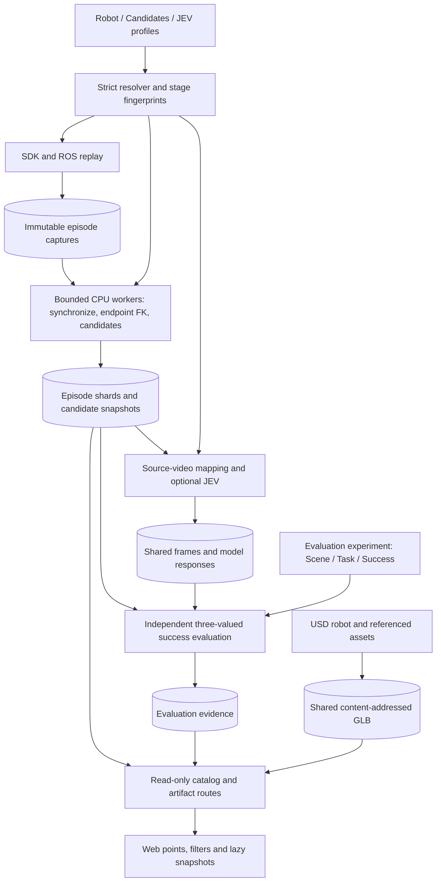

# Placement configuration and artifact architecture

Placement analysis preserves the SDK/ROS feedback capture contract while making
offline stages independently repeatable. It does not replace measured feedback
with dataset targets or run a second simulation path.



## Configuration composition

Placement experiments use `schema_version: 3`; new evaluation experiments use
`schema_version: 4`. Both declare an explicit `kind`:

- `placement_test`: `name`, optional `status` (default `ready`), `robot`,
  `candidates`, `jev`, `source`, optional `robot_placement`, `runtime` and `output`.
- `evaluation`: `name`, `robot`, `scene`, `task`, optional
  `robot_placement`, `runtime` and `output`. Runtime supports physics `dt` and
  `decimation` under `simulation`, and `max_steps` under `evaluation`.

The interactive `astribot_simulation_integrate.py` entrypoint removes legacy
`max_steps` from its resolved runtime and runs continuously until closed or
interrupted. The checked-in evaluation runtime has no step limit. The general
evaluator retains finite-budget support for other callers.

The three placement entries are `config/placement_distribution/{press_cube,
penholder,cap_pen}.json`, with `candidates/` and `jev/` in the same directory.
Evaluation entries live under `config/experiments/evaluation/` and reference shared
`config/robots/`, `assets/`, `scenes/`, `tasks/` and `runtime/` profiles.
Placement rejects `scene`, `task` and `success`; evaluation rejects placement
candidate/JEV/source settings. Success belongs to `task.success`, alongside its
instruction, reset and stages. `cap_pen` and `press_cube` criteria remain
unconfigured (`unknown`); `penholder` and its `table_penholder` alias provide an
ordered pick/place task with measured geometric predicates.

Each section is inline or uses `{ "ref": "relative/profile.json", "overrides":
{ ... } }`. References resolve relative to the declaring file. Object overrides
merge recursively; arrays, scalar values and new reference descriptors replace
their predecessor. Cycles,
duplicate JSON keys, unknown schema fields and invalid cross-references are rejected.
Simulation overrides may change only keys declared in the selected simulator YAML.
Robot model and simulation-config paths retain repository-root-relative semantics;
absolute paths are also supported. Existing backend YAML files remain in
`config/astribot_s1/`.

`src/simulation_config/` owns CPU-only resolution, robot mapping, scene adapters
and configuration validation. It does not import placement runtime modules.
Legacy flat and modular v1 inputs remain explicit read adapters. V2 evaluation
already contains `task.success`; v3 evaluation's top-level `success` is moved into
the resolved task. V4 rejects a top-level `success`. Task fingerprints include
the criteria, instruction, reset and stages. The normalized
internal `settings.task` record retains name/dataset/readiness for existing capture
and bundle readers; it is not a reference to an evaluation task. Authored v2/v3 placement experiments and their
`_resolved_sections` do not contain that legacy task section.

| Section | Ownership |
| --- | --- |
| robot | Model, SDK/feedback joint mapping, grippers, TCP and simulation configuration |
| robot_placement | Optional experiment world XY/yaw and geometry-minimum grounding; absent on historical inputs |
| candidates | Detector thresholds and `selection.exclude_initial` (default true) |
| jev | Original-video request, choice order, decision thresholds and transport |
| source | Dataset name, optional root, command column and metadata policy |
| runtime | Placement alignment/replay cadence, or evaluation physics settings and step budget |
| output | Placement capture/bundle paths and publication; evaluation reserves `root` |
| scene (evaluation) | Object labels/roles, calibrated frames/regions and supported physical scene settings |
| task (evaluation) | Instruction, reset selection, event selectors, ordered stages and success predicates |

A placement config may omit `source.dataset_root`: replay then requires an explicit
input path or `--data-root`. Identification requires a root only when the original
source and verified archived evidence cannot locate the data. Dataset readiness
belongs to the placement experiment and does not gate independent evaluation.

`RobotProfile` is shared by replay, capture, synchronization, FK and export.
`build_simulation_config` constructs a simulator mapping without starting it.
The separate simulator process is not automatically reconfigured by replay. For
explicit geometry-grounded experiments, capture requires a matching fresh runtime
placement attestation before sending SDK commands. Historical captures retain their
original coordinates and source metadata. A path-only move leaves effective
settings and cache identities unchanged; changing actual robot placement enters
capture, extraction and geometry identities.
Legacy replay observes placement feedback when available and rejects an
explicitly grounded simulator. An older simulator without that topic remains
compatible under the original authored-world fixed-base assumption; its actual
placement is not attested. New declarations require valid recorded placement
evidence during both extraction preflight and capture resume.

`robot.initial_joint_positions` optionally maps model joint names to radians;
unlisted joints start at zero. Geometry grounding uses this initial posture and
the complete robot solid geometry to place its minimum height at world Z=0,
with an upright base and the experiment's world XY/yaw. Creation and reset use
the same resolved root and joint state. Whole-robot placement leaves local TCP
and camera calibrations unchanged.

`build_experiment_simulation_config` in
[`scene_profile.py`](../src/simulation_config/scene_profile.py) composes that robot
configuration with `scene.simulation` for evaluation. Placement uses the minimal
ground/light environment defaults without a task scene. The simulator entrypoint consumes it with
`python astribot_simulation.py --experiment <experiment.json>`; add `--check-config`
to resolve on CPU before importing the factory, ROS or Isaac. Existing `--config`
YAML launches remain available. Launching from an experiment currently requires
the supported S1 USD root `/World/astribot_whole_body`.

Scene simulation fields cover:
ground enable/color, dome-light enable/intensity/color, an optional background USD
and its pose, and the three authored cameras' enable/resolution/body-path mapping.
Camera optics and link-relative extrinsics remain authored in USD (`spawn=None`);
body-path syntax is checked before launch, while camera prim availability is a
runtime sensor contract. The CPU-only
[`isaac_scene_config.py`](../src/simulation_config/isaac_scene_config.py) validates
these settings and supplies the backend's spawn configurations. Scene simulation
changes enter capture provenance; they do not invalidate candidate extraction
from unchanged recorded feedback.

`scene.frames` maps a frame name to `parent`, `position` and
`quaternion_wxyz`. Parents may be `world`, `base`, or another named frame; cycles
and non-unit quaternions are rejected. Regions can select those frame names.
The evaluator composes their transforms and evaluates recorded TCP coordinates
in the calibrated frame. These transforms must come from the experiment's
calibration; the shipped profiles make no additional calibration assumptions.

## Stage dependencies and execution

1. Capture records actual SDK calls and ROS joint feedback per episode. Resume
   checks source hashes, declared control/runtime inputs and capture hashes.
2. Synchronization validates each capture once on a cache miss. Its identity
   includes capture contents, feedback mapping and interpolation policy.
3. FK caches base/wrist endpoint poses independently of TCP offsets and detector
   thresholds. Its identity includes the compiled kinematic tree, authored
   transforms, requested endpoints and synchronized input.
4. Candidate extraction transforms endpoints into TCP coordinates, computes
   detection and startup annotations, then computes full robot poses only at
   candidate/reference frames. Diagnostic derivatives use the same fit windows
   as the original implementation, evaluated only where needed.
5. Recognition maps event times through actual command issuance to original
   video frames. Frame caches depend on video content/frame; request caches
   depend on encoded image, endpoint, question, ordered choices and model.
   Decision thresholds can be changed without requesting the model again.
   Verified archived frames can be reused without the original videos when
   source selection is unchanged. An explicit `--data-root` always requests
   source revalidation. Decisions are recomputed from cached probabilities.
6. Explicit `python -m src.evaluation.placement --experiment <evaluation.json>` consumes existing evidence and never requests JEV or
   controls the robot. Results are `passed`, `failed` or `unknown`; explicit
   contact evidence is required for contact predicates.

The separate evaluation command accepts `--observations` with strict JSON such as:

```json
{"episodes":{"episode_000080":{"button_contact":{"kind":"contact","value":true,"source":"sensor-log:frame-12"}}}}
```

The `evidence` field of a success predicate names `button_contact`. Unknown
episode IDs and caller-supplied `events_complete` are rejected; completeness is
owned by the pipeline. Observation content is retained with evaluation evidence.
Missing observations produce `unknown`, not inferred contact. Offline evaluation runs through its separate explicit entrypoint. Online evaluation
uses the same predicates and `env.evaluation_state()` after actual reset/step;
the step budget never claims that an unobserved event stream is complete. Background incremental CPU subprocesses
use `--extract-timeout` (3600 seconds by default) and are cancelled as owned
process groups when replay is interrupted.

An `object_in_region` predicate names a scene `object` and `region`. Offline
object evidence uses `episodes.<id>.objects.<name>` with a nonempty `source` and
`pose_world` or `pose_base` in `[x,y,z,qw,qx,qy,qz]` order. Online evidence reads
current rigid body state and derives `pose_base` from the actual robot base pose,
including its translation and yaw. Configured spawn poses are not evidence.
Missing state remains `unknown`; an observed body origin outside the region is `failed`. These predicates
measure object body origins and do not imply contact, stability or completed insertion.
The report retains the measured snapshot, success configuration and fingerprints.

Asset profiles define the source GLB digest, Z-up conversion, explicit scale,
static/dynamic collision and support surfaces. Optional `asset.material.metallic`
and `roughness` values in [0, 1] override the corresponding GLB material channels
on every authored USD visual material, preserving colors, textures and geometry.
`scene.objects` references assets
and initial `placement.frame` (for example `table.tabletop`). Geometry minimum
height is computed after the object's rotation and scaling. The tabletop frame
is centered on the actual white panel's top surface. Object bodies become
independent after spawning. Without `task.reset`, reset restores initial states. Regions may
use world/base or static calibrated frames; frames attached to dynamic objects
represent initial placement only and are rejected as region anchors. See the
`penholder` scene and evaluation entry for the complete composition.

The task layout follows the ownership used by x2real's
`manaenv/defination/x2real/task/bimanual_collaboration/object_to_cup/vnext_dag.yaml`:
task instructions, explicit runtime sampling targets and ordered stage nodes with
their own success criteria. This repository keeps its JSON predicate vocabulary;
it does not load x2real component factories. `task.reset.objects` selects dynamic
objects; `reset.placement` declares a static asset `surface`, `min_separation` in
meters and a bounded `max_attempts`. `type: uniform_on_surface` samples the usable
surface. `type: uniform_in_bounds` instead requires each selected scene object's
`placement.reset_xy_bounds`, with finite two-element `min`/`max` vectors and
strictly positive area. The limits are object-origin coordinates in meters in
the object's placement frame, which must equal the selected support surface.
They do not contain Z and are not scaled by the sampled object's size. A reset
with configured bounds cannot silently use `uniform_on_surface`.

Bounded sampling intersects these limits with the surface's feasible origin
rectangle after accounting for the full rotated/scaled object footprint; it
does not subtract the footprint from the calibrated limits again. Empty
intersections and exhausted collision retries fail without falling back to the
whole table. All modes preserve configured orientation and use `geometry_min`
plus `clearance` for Z. Only selected object poses and velocities are reset.
The existing environment reset also restores robot joints and clears task progress.

`type: empirical` requires the same bounds plus a nonempty `reset_xy_samples`
array of finite XY observations on every selected object's placement. All arrays
must have equal length; a shared row index represents one joint observation of
all selected objects. The sampler draws a row with equal probability, keeping
duplicate observations and thus their empirical mass. Every selected object
uses that row. Invalid support/overlap draws reject the whole row and retry;
points are never clipped or replaced with uniform samples. The resulting
distribution is the empirical distribution conditioned on feasible placement.
Bounds and samples are in meters in the shared support frame. Samples must lie
within the configured bounds, and cannot be used with a uniform reset mode.

Penholder stores 310 paired observations ordered by episode 000000 through
000309: pen is the grasp TCP XY and penholder is the release TCP XY. Equal row
sampling preserves the density peaks and the episode's relative layout, with no
Gaussian fit or positional jitter. Calibration projects saved `tcp_pose_base`
XY through the configured robot base placement into `table.tabletop`; recorded
candidate Z is discarded.
With base XY `[0, 0]`, yaw zero and table XY `[0.6, 0]`, yaw 90 degrees, the mapping
is `x_table = y_base`, `y_table = 0.6 - x_base`. These are static calibrated limits:
recalibrate them if the table/base horizontal placement changes. Runtime reset
does not read replay artifacts or require the dataset.

`task.stage_order` explicitly lists every stage once, independent of JSON key order.
A stage declares either existing `events`/`ordered` or its own `success` predicates.
Online evaluation retains passed stage evidence, advances at most one new stage
per snapshot and clears that history on reset. A lone offline final snapshot cannot
establish the history of the two-stage task. `task.success` combines stage results.
The `object_relative_region` predicate transforms an object's local `point` into
the measured `relative_to` object's frame, tests `min`/`max` bounds and optionally
checks `min_axis_dot` between their +Z axes. Both measured world poses and sources
are required; a configured dynamic spawn frame is never substituted.

The calibrated table GLB has source axes X/Y/Z of 1.40/0.75/0.70 m and is rotated
to Z-up. The table placement is world XY `[0.6, 0]`, yaw 90 degrees, with its feet
grounded at Z=0 and tabletop at Z=0.75 m. The robot base placement is `[0, 0]`.
The pen tip proxy is local `[0, 0, -0.07]` m. The holder interior acceptance box is
`[-0.043, -0.043, -0.05]` to `[0.043, 0.043, 0.04]` m in the current holder frame,
with `min_axis_dot: 0.8`. These tunable geometric proxies do not establish grasp,
release, contact or stable insertion. Pen/holder dimensions retain their prior
asset scales; only the table dimensions were supplied as physical calibration.

Extraction uses bounded process workers and one manifest coordinator. Each
completed episode writes a shard/checkpoint; a failed run can resume without
replaying or reserializing all previous episodes. Incremental mode can process
completed captures from a partial batch. During replay, a coalescing background
coordinator overlaps offline extraction with capture; interim work excludes
identification/publication, and final processing runs after it drains.

No-op extraction resume preserves completed recognition/evaluation revisions.
Adding captures creates a new analysis identity and invalidates downstream
stages. Changing candidate settings requires a new output directory, while
compatible synchronization/FK artifacts can still be reused.

## Storage and Web boundary

`ArtifactStore` writes immutable content-addressed objects and verifies their
digest, size and confined path. Schema 5 `placement.json` references episode
event shards, separate snapshots, one reference pose and shared GLB geometry.
The geometry cache includes referenced USD dependencies and exporter identity.
Separate stage metadata distinguishes capture/extraction completion,
identification failures and task-success results.

Publication records an immutable manifest revision and permitted artifact
closure in the viewer catalog. It does not copy the bundle or model into a
second public tree. The existing Vite middleware serves only registered
artifacts; mutation methods are rejected. Content-addressed URLs are immutable
and cacheable. The viewer fetches point data first, full snapshots on demand,
and keeps the same model when its content URL is unchanged.

Schema 5 includes display event types, labels and authoritative analysis-selection
annotations. Web filtering is a view operation and does not redefine candidate
selection or task success. Legacy schema 1–4 and old public-directory pairs use
the existing compatibility reader; historical files are not automatically moved,
deleted or reinterpreted as new analyses.

Current recognition screenshots and raw model responses remain local evidence;
the viewer consumes labels/probabilities, not an unrestricted artifact directory.
Automatic garbage collection is intentionally absent: old revisions and shared
references must be accounted for before deleting immutable objects.

## Validation scope

CPU regression tests compare complete event dictionaries and snapshots between
the original full-trajectory calculation and the optimized endpoint calculation.
Cache tests cover changed captures, mapping, kinematics, alignment, TCP and
detector parameters; process tests compare serial and spawned-worker output.
Recognition tests use tiny local videos and mocked model calls. Browser tests
cover schema compatibility, lazy snapshot fetching, unchanged-model reuse and
actual Python publication through the Vite routes.

These checks do not prove live SDK timing, multi-instance simulation throughput
or remote-model latency. Replay speed scaling changes motion timing and is not
used as an equivalent-computation optimization.
